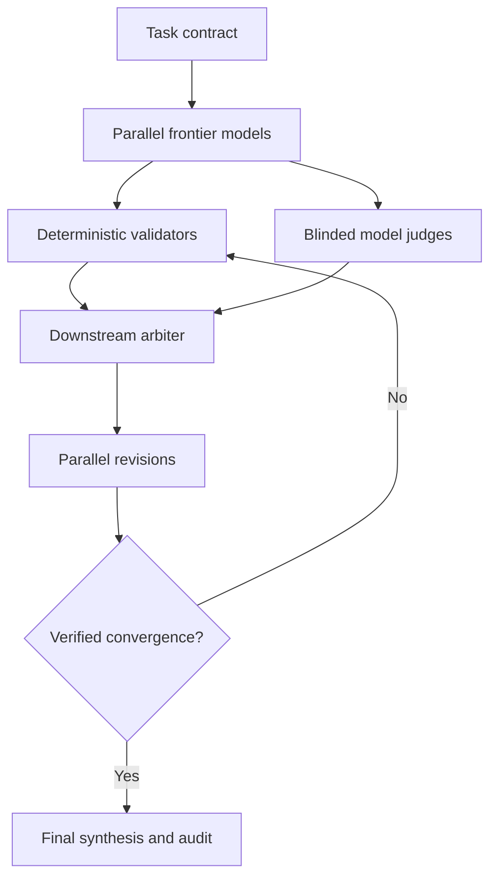

# OMNI Intelligence

**Orchestrated Multi-Model Networked Inference**

OMNI is a provider-agnostic decision mesh that sends the same task to multiple frontier models simultaneously, evaluates their independent outputs, returns structured downstream feedback, and repeats the process until the system reaches verified convergence or a bounded stopping condition.

It is designed around a simple premise: the best answer may not come from choosing one model. It may come from preserving useful disagreement across several models while systematically removing unsupported claims.

## Architecture



Each iteration follows six steps:

1. **Generate independently.** Frontier models receive an identical task contract in parallel.
2. **Validate mechanically.** Code checks word limits, required fields, totals, schemas, and task-specific numerical traps.
3. **Evaluate blindly.** One or more judges score anonymized candidates against a fixed rubric.
4. **Arbitrate downstream.** An arbiter identifies verified common ground, unsupported claims, unresolved disagreement, and next-round directives.
5. **Revise in parallel.** Each frontier model receives its prior answer, the anonymized alternatives, and the arbiter memo.
6. **Stop safely.** The system exits on verified convergence, a quality plateau, a cost ceiling, or the maximum number of rounds.

Convergence is not majority vote. OMNI requires hard constraints to pass and combines rubric quality, inter-judge disagreement, and response convergence. Similar answers that repeat the same error do not qualify as verified convergence.

## Pilot

The included pilot replays four anonymized responses to a synthetic marketing-budget problem. A human-defined rubric produced scores of 95, 89, 71, and 55. The lower-scoring responses sounded technically sophisticated but converted ambiguous experiment descriptions into unsupported dollar estimates.

This is an illustrative systems test, not a statistically powered model benchmark. Only one latency value was captured, and the model identities remain blinded.

Reproduce the pilot:

```bash
PYTHONPATH=src python -m omni_intelligence.cli pilot \
  --task examples/marketing_budget_task.json \
  --candidates examples/pilot_candidates.json \
  --output reports/pilot_report.json
```

Expected ranking:

```text
1. response-1: 95.0/100 (12.0s)
2. response-2: 89.0/100 (unknown)
3. response-3: 71.0/100 (unknown)
4. response-4: 55.0/100 (unknown)
```

## Run a live frontier mesh

The prototype contains adapters for OpenAI-compatible APIs, Anthropic, and Gemini. It uses only the Python standard library and reads credentials from environment variables.

1. Copy `examples/models.example.json` to a private configuration file.
2. Insert current model identifiers and optional per-token pricing.
3. Enable at least two solvers, one or more blinded judges, and a downstream arbiter.
4. Set the referenced API-key environment variables.
5. Run:

```bash
PYTHONPATH=src python -m omni_intelligence.cli run \
  --task examples/marketing_budget_task.json \
  --models path/to/models.private.json \
  --output reports/live_run.json
```

Model names and prices are intentionally not hard-coded because both change. Never place API keys in the JSON configuration or commit them to source control.

## Stopping logic

The default loop allows three rounds and stops when any of these conditions is met:

- **Verified convergence:** the best candidate exceeds the quality threshold, hard validators pass, frontier outputs converge, and judge disagreement is below its threshold.
- **Quality plateau:** score improvement remains below the configured minimum while hard constraints pass.
- **Cost ceiling:** estimated API cost reaches the configured maximum.
- **Maximum rounds:** the system reaches its explicit iteration limit.

This prevents the word “continuous” from becoming an unbounded—and expensive—feedback loop.

## Evaluation principles

- Model identities are hidden from judges.
- Candidate order is randomized for each judge.
- Deterministic checks run separately from model judgment.
- No model is asked to expose private chain-of-thought.
- Agreement is treated as a signal, not evidence.
- Missing latency or cost is recorded as unknown rather than invented.
- Human review remains the final gate for consequential decisions.

## Test

```bash
PYTHONPATH=src python -m unittest discover -s tests -v
```

## Project status

Version 0.1 is a tested research prototype. The replay path and deterministic checks run locally. Live provider execution requires valid API credentials and current model identifiers and has not been represented as a completed comparative experiment.

## Author

Brian James Curry  
Vector1 Research

